---
title: Agenda for Discussion
routeAlias: agenda
---

<Fit>

  

    
Introduction to Robotics

    <Link to="flowchart" class="agenda-item">
01

Flowchart
</Link>
    <Link to="what-is-a-robot" class="agenda-item">
02

What is a Robot?
</Link>
    <Link to="robot-components" class="agenda-item">
03

Major components of a robot
</Link>
    <Link to="quick-recap" class="agenda-item">
04

Quick recap
</Link>
    <Link to="alphabot" class="agenda-item">
05

Spark bot
</Link>
  

  

    
Components on Spark bot

    <Link to="sensors" class="agenda-item">
06

Sensors
</Link>
    <Link to="actuators" class="agenda-item">
07

Actuators
</Link>
    <Link to="control" class="agenda-item">
08

Control
</Link>
    <Link to="power" class="agenda-item">
09

Power
</Link>
    <Link to="communication" class="agenda-item">
10

Communication
</Link>
    <Link to="indicating-devices" class="agenda-item">
11

Indicating devices
</Link>
    <Link to="alphabot-recap" class="agenda-item">
12

Quick recap
</Link>
  

</Fit>

---
title: Workshop Flowchart
kicker: Introduction to Robotics
routeAlias: flowchart
---

  
Introduction to Spark bot

  

  
I/O Masking

  

  
Motion Control

  

  
PWM

  

  
Ultrasonic Sensor

  

  
ADC

  

  
White Line Following

---
title: Robot vs Machine
kicker: Introduction to Robotics
routeAlias: what-is-a-robot
class: body-top
---
<v-clicks depth="2">

- **What is a Robot?**
  - A machine that can sense, decide, and act automatically.
- **Is a washing machine a robot?**
  - It performs mechanical tasks but cannot make intelligent decisions.
- **How can we convert a washing machine into a robot?**
  - By adding sensors, controllers, and autonomous decision logic.

</v-clicks>

---
title: Difference between a robot and a machine
kicker: Introduction to Robotics
class: big-table body-top
---

| Machine | Robot |
|---|---|
| Performs mechanical work | Performs tasks automatically |
| Fixed behavior | Can adapt based on conditions |
| No sensing capability (mostly) | Uses sensors to detect environment |
| Cannot make decisions | Makes decisions based on logic/program |
| Cannot be reprogrammed | Easily reprogrammable |
| Example: Washing machine | Example: Spark bot |

---
layout: two-cols
kicker: Introduction to Robotics
routeAlias: robot-components
class: cols-center
---

What are the Major Components needed for designing a Robot?

::right::

---
title: Major components of robot
kicker: Introduction to Robotics
class: body-top highlight-current
---

 <!-- ← GAP between title and list: change 2rem -->

<v-clicks>

1. **Sensors:** For sensing the environment
2. **Actuators:** For movement of the robot and its parts
3. **Control:** Controller/Processor as the brain of the robot
4. **Intelligence:** User-written command(s) to perform a desired set of actions
5. **Power:** Energy required for a robot to operate and perform its tasks
6. **Communication:** Robot can talk to another robot/PC

</v-clicks>

---
title: Test your understanding
kicker: Introduction to Robotics · Quick recap
routeAlias: quick-recap
class: highlight-current quiz
---

<v-clicks>

1. What is the difference between a machine and a robot?
2. What are the major components of a robot?
3. Why do we need sensors in a robot?
4. What is the role of an actuator in a robot?

</v-clicks>

---
layout: nofit
title: Spark bot
kicker: Introduction to Robotics
routeAlias: alphabot
---

<figure class="fig">
  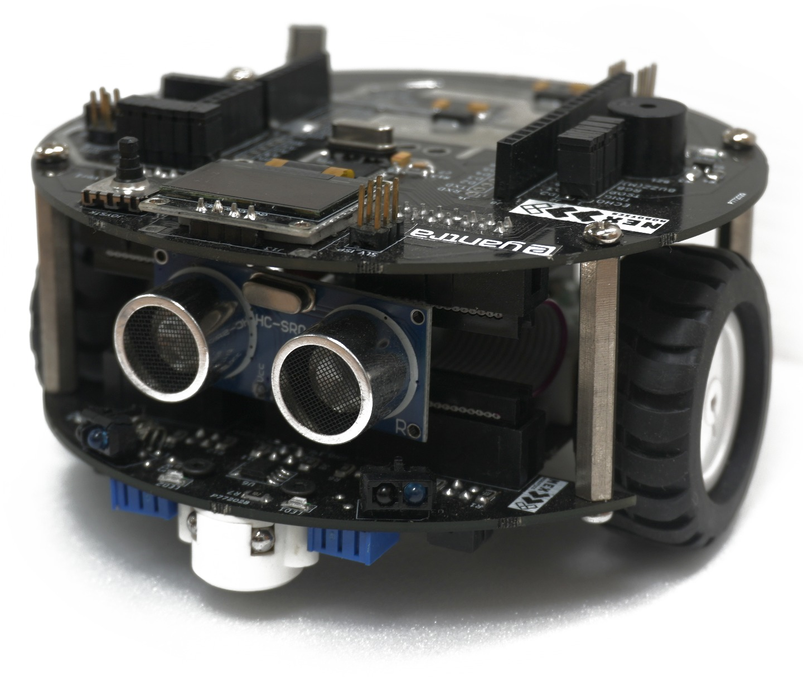 <!-- ← image size: change 16.5rem -->
  <figcaption>Spark bot</figcaption>
</figure>

---
layout: two-cols
title: IR Proximity Sensors
kicker: Sensors on Spark bot · 1 of 4
routeAlias: sensors
class: cols-center big-points
---

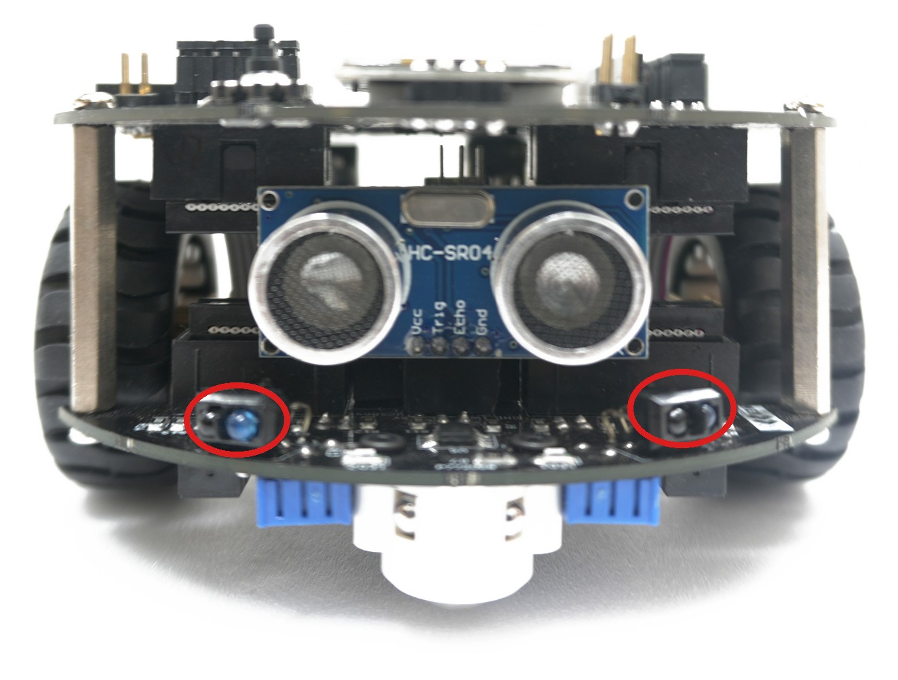

::right::

<v-clicks>

1. **Transmitter:** IR LED **Receiver:** Phototransistor
2. **Count on Spark Bot:** 02
   - IRP_L(Left)
   - IRP_R(Right)

3. **Connected to:** Slave controller (ATmega328P)

</v-clicks>

---
layout: two-cols
title: White Line Sensors
kicker: Sensors on Spark bot · 2 of 4
class: cols-center big-points
---

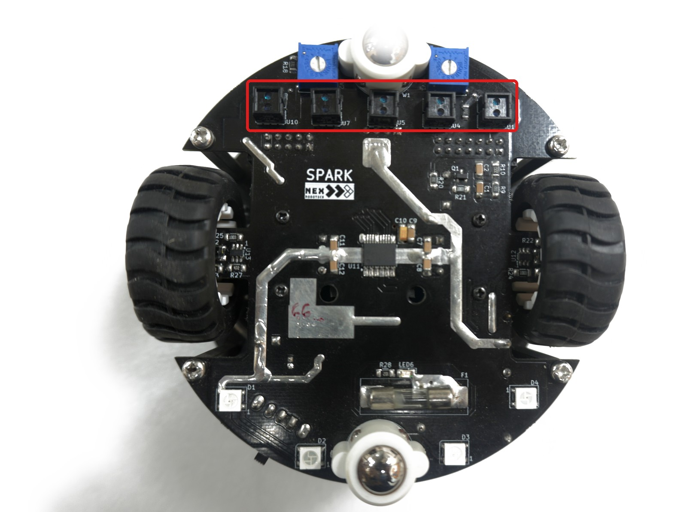

::right::

<v-clicks>

1. **Transmitter:** IR LED **Receiver:** Phototransistor
2. **Count on Spark Bot:** 01
3. **Connected to:** Slave controller (ATmega328P) internal ADC

</v-clicks>

---
layout: two-cols
title: Ultrasonic Sensor
kicker: Sensors on Spark bot · 3 of 4
class: cols-center big-points
---

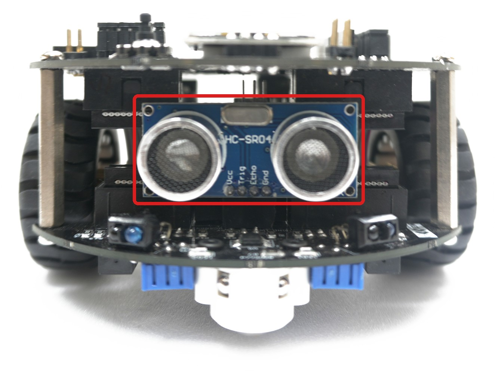

::right::

<v-clicks>

1. **Transmitter:** Ultrasonic wave transmitter and receiver
2. **Count on Spark bot:** 01
3. **Connected to:** Master controller (ATmega328P)

</v-clicks>

---
layout: nofit
title: Infrared TSOP Receiver
kicker: Sensors on Spark bot · 4 of 4
---

  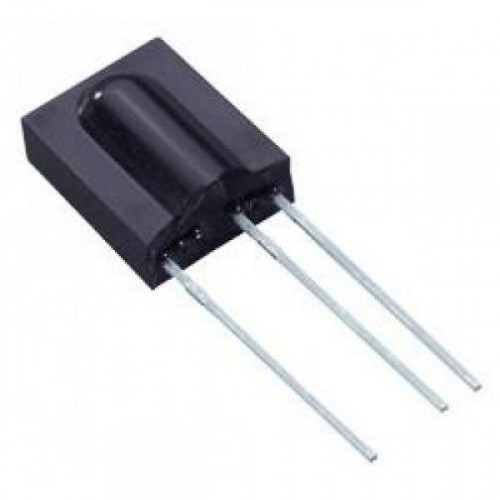
  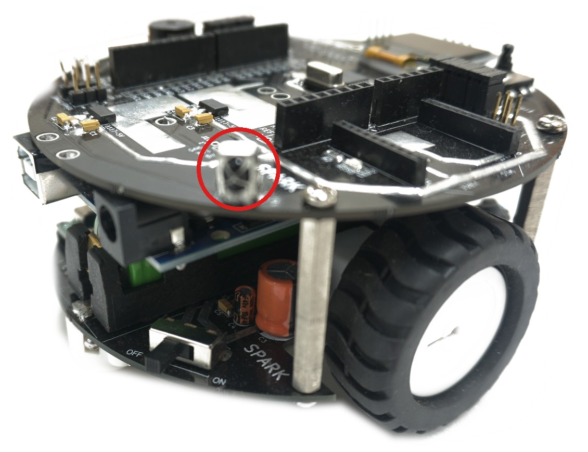

<v-clicks>

1. **Receiver:** TSOP IR Receiver
2. **Count on Spark Bot:** 01
3. **Connected to:** Master controller (ATmega328P)

</v-clicks>

---
layout: nofit
title: Actuators
kicker: Components on Spark bot
routeAlias: actuators
class: img-top
---

<v-clicks>

1. **Motor:** DC Gear Motor
2. **Connected to:** Master controller (ATmega328P)
3. **Wheel encoders:** GP2S700HCP reflective sensors
4. **Connected to:** Slave controller (ATmega328P)
5. **Count on Spark Bot:** 02 (Left and Right)

</v-clicks>

  <figure class="fig">
    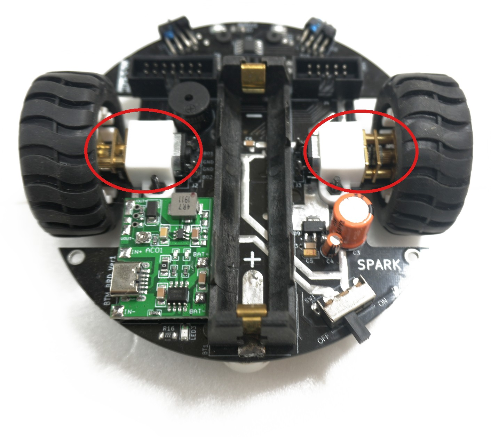
    <figcaption>Motor</figcaption>
  </figure>
  <figure class="fig">
    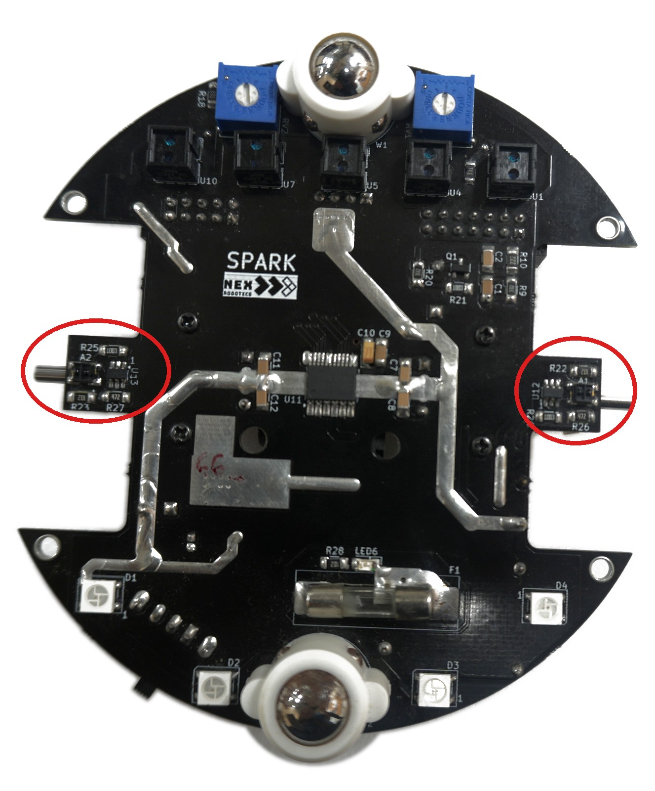
    <figcaption>Encoder</figcaption>
  </figure>

---
title: Robot control system
kicker: Components on Spark bot
routeAlias: control
---

<v-clicks>

1. **Arduino Uno: Main control board** 
   Based on ATmega328P microcontroller; interfaces with sensors and actuators.
2. **ATmega328P MCU: AVR architecture by ATMEL** 
   Features 16 MHz clock, 32 KB flash memory, 2 KB SRAM, and 14 digital I/O pins.
3. **Control Functions:** 
   Reads sensor data, executes logic, drives motors, and communicates with peripherals.

</v-clicks>

---
title: How is a robot made intelligent
kicker: Components on Spark bot
class: body-top big-list
---

<v-clicks>

1. Intelligence is achieved by implementing control logic in software.
2. The software is written in embedded C for the ATmega328P microcontroller.
3. Embedded C provides direct access to registers, ports, timers, and interrupts.
4. This enables the robot to process sensor data and generate actuator commands.

</v-clicks>

---
title: Powering the robot
kicker: Components on Spark bot
routeAlias: power
---

1. **Battery Powered:** 7.4V, 1100mAh, Li-ion battery

  <figure class="fig">
    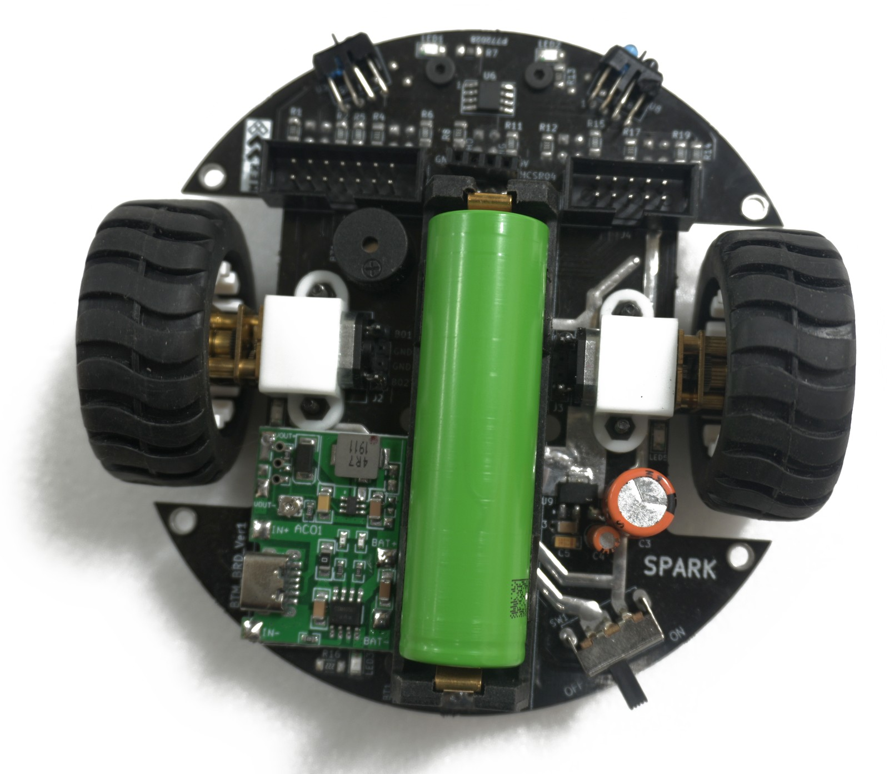
    <figcaption>Battery</figcaption>
  </figure>
  <figure class="fig">
    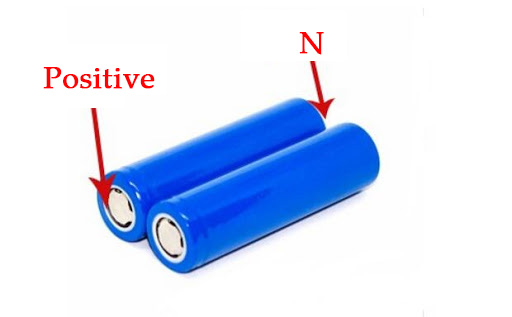
    <figcaption>Battery Polarity</figcaption>
  </figure>

<v-click>

2. 5V USB battery charging port

</v-click>

---
title: Communication
kicker: Components on Spark bot
routeAlias: communication
---

  

    
✔ Wired Communication — between Robot and System

    <ol><li>USB</li></ol>
  

  

    
✔ Wireless Communication — between Robot and System, and Robot and Robot

    <ol>
      <li>XBee and Bluetooth
        

          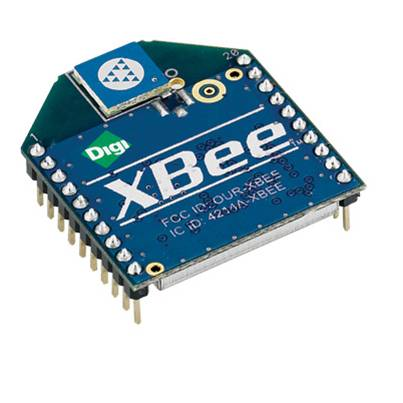
          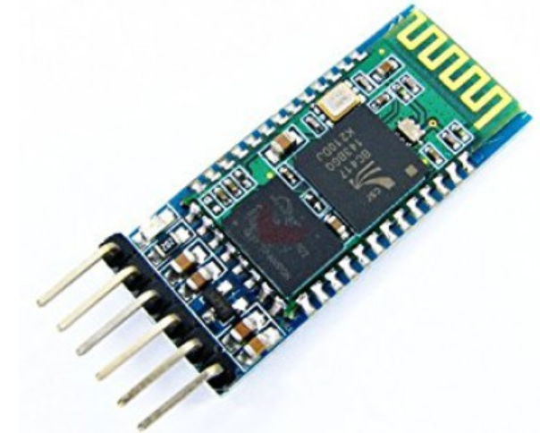
        

      </li>
      <li v-click>Infrared Remote
        

      </li>
    </ol>
  

---
title: Indicating devices
kicker: Components on Spark bot
routeAlias: indicating-devices
---

  

    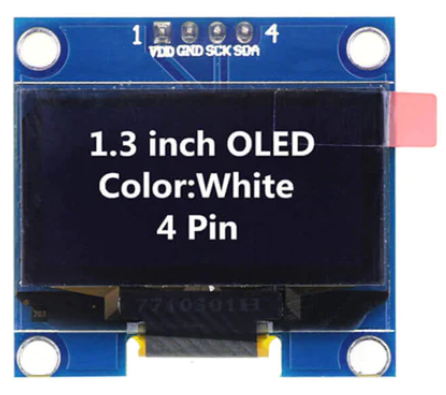
    
✔ 128x64 OLED

  

  

    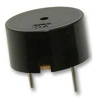
    
✔ Buzzer

  

  

    
✔ LED Array

  

---
title: Test your understanding
kicker: Components on Spark bot · Quick recap
routeAlias: alphabot-recap
class: body-top big-list
---

1. What sensors are available on Spark bot?
2. Why do we need a 5 white line sensor array on the robot?
3. Why do we need an ADC for interfacing the white line sensor?
4. What are the actuators used in Spark bot?

---
layout: nofit
title: Master and Slave Connections
kicker: Spark Bot · Block diagram
routeAlias: spark-connections
class: conn-slide
---

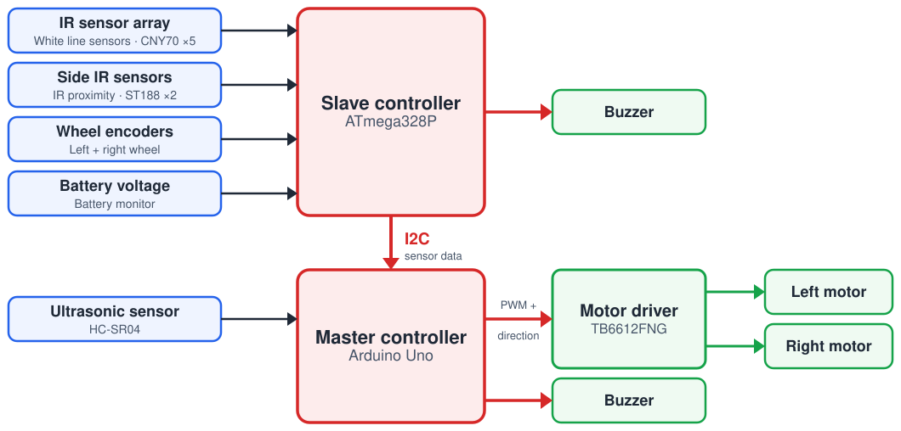

---
layout: end
title: Thank You!
subtitle: e-Yantra Workshop Series · IIT Bombay
contact: "Post your queries on: support@e-yantra.org"
---
