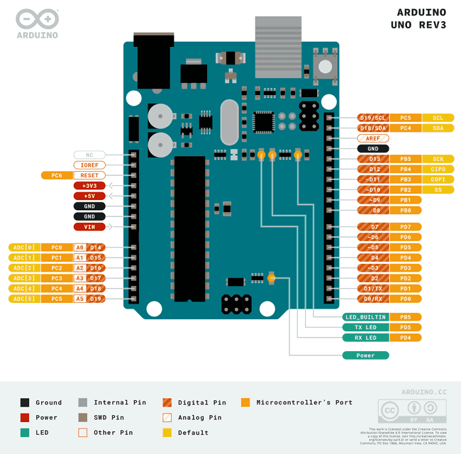
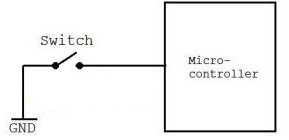
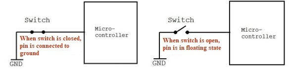
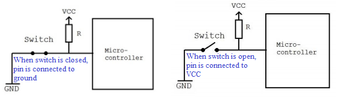
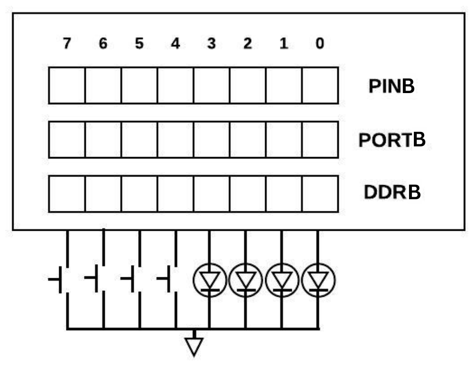
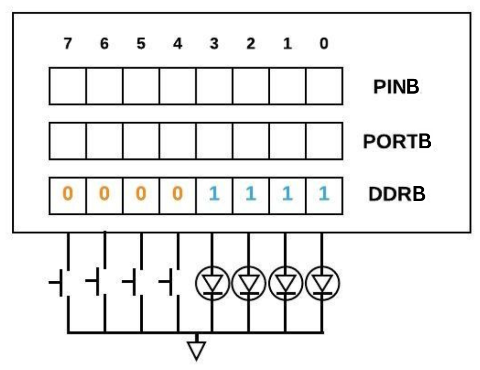
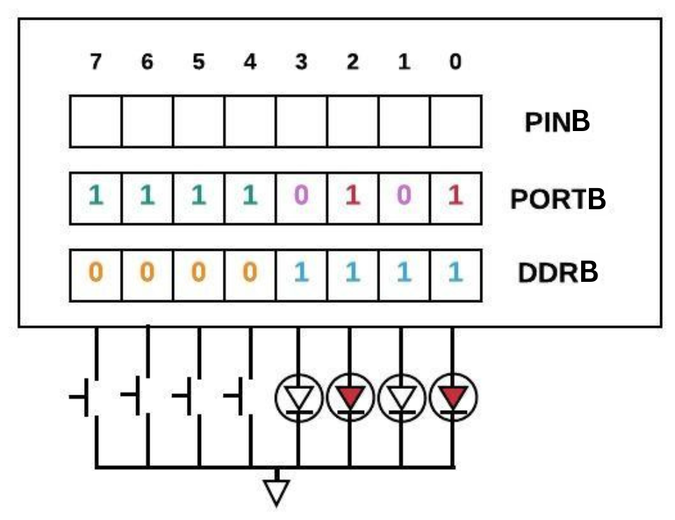
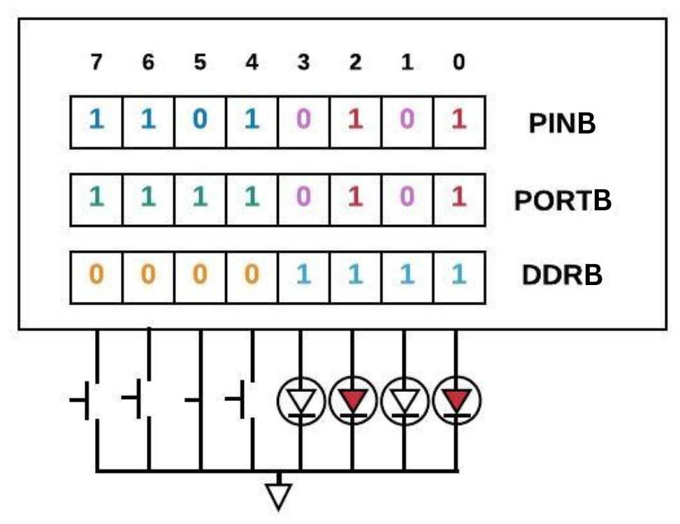
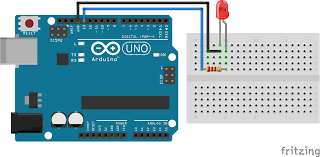

---
title: Agenda for Discussion
kicker: Outline
routeAlias: agenda
class: agenda-slide
---

  
1 · Input-Output Ports in ATmega328P

  

    <Link to="overview-ports" class="agenda-item">
01

Overview of Ports
</Link>
    <Link to="ports" class="agenda-item">
02

Ports in ATmega328P
</Link>
    <Link to="registers" class="agenda-item">
03

Overview of Registers
</Link>
    <Link to="accessing-ports" class="agenda-item">
04

Accessing Ports
</Link>
    <Link to="led-embedded-c" class="agenda-item">
05

LED Interfacing using Embedded C
</Link>
    <Link to="need-masking" class="agenda-item">
06

Need for masking
</Link>
    <Link to="masking-operators" class="agenda-item">
07

Masking Operators
</Link>
    <Link to="arduino-apis" class="agenda-item">
08

LED Interfacing using Arduino APIs
</Link>
  

---
title: What are Ports?
kicker: Overview of Ports
routeAlias: overview-ports
---

<v-clicks depth="3">

- Junctions where peripheral devices are connected.
- Peripheral devices can be:
  1. Input Device: Example: Switch, Sensors, etc...
  2. Output Device: Example: Buzzer, LCD, Motors, LED, etc...

</v-clicks>

<!-- Diagram: input devices → ATmega328P → output devices (sizes: .port-diagram in style.css) -->

  

    
Input Devices

    

      
<Icon name="lucide:toggle-right" size="1.4em" />Switch

      
<Icon name="lucide:thermometer" size="1.4em" />Sensor

    

  

  
Input port

  

    <Icon name="lucide:cpu" size="1.9em" />
    
ATmega328P

    
Ports B, C, D

  

  
Output port

  

    
Output Devices

    

      
<Icon name="lucide:lightbulb" size="1.4em" />LED

      
<Icon name="lucide:volume-2" size="1.4em" />Buzzer

      
<Icon name="lucide:monitor" size="1.4em" />LCD

      
<Icon name="lucide:cog" size="1.4em" />Motor

    

  

---
title: Ports in ATmega 328P
kicker: Ports in ATmega328P
routeAlias: ports
---

<v-clicks depth="2">

- ATmega328P is a 32 pin micro-controller.
- 23 pins can be used as Input/Output pins.
- Pins are grouped together and are called as Port.
  1. ATmega 328p has two 8-bit Ports Port x; &emsp;&emsp; x = B and D
  2. ATmega 328p has one 7-bit Port Port C;
- All Port pins can be individually configured as Input/Output.

</v-clicks>

---
layout: two-cols
title: Arduino - ATmega 328p pin mapping
kicker: Ports in ATmega328P
class: cols-center
---

::right::

<v-clicks>

1. Digital I/O Pins
2. Analog Input Pins
3. Power Pins
4. Control and Reference Pins

</v-clicks>

---
title: What are Registers?
kicker: Overview of Registers
routeAlias: registers
class: main-gap
---

<v-clicks depth="2">

- A register is a temporary memory inside the microcontroller that stores one bit.
- Used by CPU to:
  1. Configure peripherals (Example: Setting pin direction)
  2. Write data to I/O pins (Example: Turning ON/OFF an LED)
  3. Read data from I/O pins (Example: Reading switch/sensor input)
- Common Registers in ATmega328P: DDRx, PORTx, PINx

</v-clicks>

---
title: Accessing Ports
kicker: Accessing Ports
routeAlias: accessing-ports
class: center-points
---

Each Port has three associated registers with it:

<v-clicks>

1. DDRx x = B, C and D
2. PINx x = B, C and D
3. PORTx x = B, C and D

</v-clicks>

---
title: Understanding DDRx Register
kicker: Accessing Ports
class: alpha-sub title-gap
---

<v-clicks depth="2">

- Data Direction Register
- Purpose: To define Port pins as Input/Output
  1. DDRx bit = 0 → Portx pin is defined as Input.
  2. DDRx bit = 1 → Portx pin is defined as Output.
- Example: For Port B, make lower nibble as Input and upper nibble as Output.

</v-clicks>

<RegTable v-click label="DDRB =" bits="11110000" />

DDRB = 0xF0

---
title: Understanding PINx Register
kicker: Accessing Ports
class: title-gap
---

<v-clicks>

1. Purpose: To read data present on Port x pins.
2. Save the value of register in a variable.
3. Example: Read data from Port B

</v-clicks>

<RegTable v-click label="PortB =" bits="11110000" prefix="P" />

x = PINB x = 0xF0 \\1111 0000

---
title: Understanding PORTx Register
kicker: Accessing Ports
class: title-gap roomy
---

<v-clicks depth="2">

1. The **PORTx register** in the **ATmega328P** is used to control the output value of the pins and to enable or disable the internal pull-up registers for input pins.
2. It works in two cases depending on the pin configuration:
   1. **Case 1 – Output mode**
   2. **Case 2 – Input mode**

</v-clicks>

---
title: Understanding PORTx Register
kicker: Accessing Ports
class: spread
---

Case 1: &emsp; When Port x is defined as Output

<v-clicks>

1. Purpose: Send data on Port x pins
2. Example:

</v-clicks>

<RegTable v-click label="DDRB =" bits="11111111" />

DDRB = 0xFF \\1111 1111

PORTB = 0xFF \\1111 1111

---
title: Understanding PORTx Register
kicker: Accessing Ports
class: spread
---

Case 2: &emsp; When Port x is defined as Input

<v-clicks>

1. Purpose: Activate/deactivate Pull-up register

</v-clicks>

---
title: Understanding PORTx Register
kicker: Accessing Ports
class: spread
---

Case 2: &emsp; When Port x is defined as Input

1. Purpose: Activate/deactivate Pull-up register

---
title: Understanding PORTx Register
kicker: Accessing Ports
class: spread
---

Case 2: &emsp; When Port x is defined as Input

1. Purpose: Activate/deactivate Pull-up register

---
title: Understanding PORTx Register
kicker: Accessing Ports
class: alpha-sub
---

Case 2: &emsp; When Port x is defined as Input

<v-clicks depth="2">

1. Purpose: Activate/deactivate Pull-up register
   1. PORTx bit = 1 → Pull up is activated on Portx pin.
   2. PORTx bit = 0 → Pull up is deactivated on Portx pin.
2. Example:

</v-clicks>

<RegTable v-click label="DDRB =" bits="00000000" />

DDRB = 0x00 \\0000 0000

PORTB = 0xFF \\1111 1111

Pull-Up is activated for all Pins of PortB.

---
title: Examples
kicker: Accessing Ports
---

- Example 1: Make PortD as output port and send hex value 'D5'.

<v-clicks>

1. Step 1: Make Port D as Output port

</v-clicks>

<RegTable v-click label="DDRD =" bits="11111111" />

DDRD = 0xFF \\1111 1111

<v-clicks>

2. Step 2: Put data on the Port D

</v-clicks>

<RegTable v-click label="PORTD =" bits="11010101" />

PORTD = 0xD5 \\1101 0101

---
title: Examples (Cont..)
kicker: Accessing Ports
---

- Example 2: Make PortB input port with pull-up activated on all pins

<v-clicks>

1. Step 1: Make Port B as Input port

</v-clicks>

<RegTable v-click label="DDRB =" bits="00000000" />

DDRB = 0x00 \\0000 0000

<v-clicks>

2. Step 2: To activate Pull-up register send data on Port B

</v-clicks>

<RegTable v-click label="PORTB =" bits="11111111" />

PORTB = 0xFF \\1111 1111

---
title: Examples
kicker: Accessing Ports
---

- Example: Connect LEDs to lower nibble and Switches to upper nibble of PortB. Turn ON alternate LEDs (0 and 2) and activate pull-up for all switches. Read data using PIN register. What will be the content of PINB register if only the switch at pin 5 is pressed?

---
title: Examples
kicker: Accessing Ports
---

- Step 1: Make upper nibble as Input and lower nibble as Output.

---
title: Examples
kicker: Accessing Ports
---

- Step 2: Turn ON alternate LEDs (0 and 2) and activate pull up for Switches.

---
title: Examples
kicker: Accessing Ports
---

- Step 3: Read data from PINB. On lower nibble we will get the same data and on upper nibble depending on Switch position, data will change.

---
title: LED Interfacing on Spark bot
kicker: LED Interfacing using Embedded C
routeAlias: led-embedded-c
---

<v-clicks>

1. LED is connected to Port B pin 5 (Digital pin 13)

</v-clicks>

<v-clicks>

2. To turn ON LED: send logic HIGH on pin 5 of Port B
3. To turn OFF LED: send logic LOW on pin 5 of Port B

</v-clicks>

---
title: LED Program
kicker: LED Interfacing using Embedded C
class: title-gap roomy
---

<v-clicks>

1. Configure PB.5 pin as Output.
   
DDRB = 0x20; // 0010 0000

2. To turn ON the LED set PB.5 output HIGH
   
PORTB = 0x20; // 0010 0000

3. To turn OFF the LED set PB.5 output LOW
   
PORTB = 0x00; // 0000 0000

</v-clicks>

---
title: Need for masking
kicker: Need for masking
routeAlias: need-masking
class: centered wide-gaps
---

<v-clicks>

1. Sometimes, we need to change the state of one or more pins of a port while keeping the rest of the pins unchanged.
2. AVR is not bit addressable.
3. No 'address' to a specific bit.

</v-clicks>

---
title: Masking Operators
kicker: Masking Operators
routeAlias: masking-operators
class: spread
---

In general, there are three operators used for masking:

<v-clicks>

- OR operator → to SET a particular bit
- AND operator → to RESET a particular bit
- EXOR operator → to TOGGLE a particular bit

</v-clicks>

Two more operators can be used:

- NOT operator
- Shift operators

---
title: NOT Operator
kicker: Masking Operators
class: spread
---

<v-clicks>

1. Purpose: To perform negation on all bits.
2. Symbol: ∼
3. Example:

</v-clicks>

<RegTable v-click label="A =" bits="10000011" prefix="B" />

<RegTable v-click label="∼ A =" bits="01111100" prefix="B" />

---
title: Shift Operator
kicker: Masking Operators
---

<v-clicks>

1. Purpose: To shift all bits by specified bit position.
2. Types: Left Shift and Right Shift
3. Symbol: Left shift (<<) and right shift (>>)
4. Example:

</v-clicks>

<RegTable v-click label="A =" bits="10000011" prefix="B" />

<RegTable v-click label="A<<2 =" bits="00001100" prefix="B" />

<RegTable v-click label="A>>2 =" bits="00100000" prefix="B" />

---
title: OR Operator
kicker: Masking Operators
class: spread big-truth
---

<v-clicks>

1. Purpose: To SET particular bit/s.
2. Symbol: |
3. Truth Table:

</v-clicks>

<table v-click class="truth">
  <thead><tr><th>A</th><th>B</th><th>Output</th></tr></thead>
  <tbody>
    <tr><td>0</td><td>0</td><td>0</td></tr>
    <tr><td>0</td><td>1</td><td>1</td></tr>
    <tr><td>1</td><td>0</td><td>1</td></tr>
    <tr><td>1</td><td>1</td><td>1</td></tr>
  </tbody>
</table>

---
title: Example
kicker: Masking Operators
---

<v-clicks>

1. Example: Setting a bit :
2. Consider register has data 0x83 (unknown to us). We want to set 2nd bit of register and keep rest of the data intact.

</v-clicks>

<RegTable v-click label="REGISTER =" bits="10000011" prefix="B" />

<v-clicks>

3. Expected output is:

</v-clicks>

<RegTable v-click label="OUTPUT =" bits="10000111" prefix="B" />

---
title: Example
kicker: Masking Operators
---

<RegTable label="REGISTER =" bits="10000011" prefix="B" />

OR

<RegTable v-click label="MASK =" bits="00000100" prefix="B" />

Output same as Expected output:

<RegTable v-click="4" label="OUTPUT =" bits="10000111" prefix="B" :red="[2]" />

<v-clicks>

1. register_name = register_name | 0x04;
2. register_name |= 0x04;

</v-clicks>

---
title: Example of Masking with Shift Operator
kicker: Masking Operators
class: centered mid-gaps
---

<v-clicks>

1. register_name |= 0x04;
2. 0x04 can also be written as 1 &lt;&lt; 2
3. In general, a statement can be written as: register_name |= (1 &lt;&lt; pin_no);
4. For setting multiple bits at once: register_name |= ((1 &lt;&lt; pin_no1) | (1 &lt;&lt; pin_no2));

</v-clicks>

---
title: AND Operator
kicker: Masking Operators
class: spread big-truth
---

<v-clicks>

1. Purpose: To RESET particular bit/s.
2. Symbol: &
3. Truth Table:

</v-clicks>

<table v-click class="truth">
  <thead><tr><th>A</th><th>B</th><th>Output</th></tr></thead>
  <tbody>
    <tr><td>0</td><td>0</td><td>0</td></tr>
    <tr><td>0</td><td>1</td><td>0</td></tr>
    <tr><td>1</td><td>0</td><td>0</td></tr>
    <tr><td>1</td><td>1</td><td>1</td></tr>
  </tbody>
</table>

---
title: Example
kicker: Masking Operators
---

<v-clicks>

1. Example: Resetting a bit :
2. Consider register has data 0x87 (unknown to us). We want to reset pin 2 and keep rest of the data intact.

</v-clicks>

<RegTable v-click label="REGISTER =" bits="10000111" prefix="B" />

<v-clicks>

3. Expected output is:

</v-clicks>

<RegTable v-click label="OUTPUT =" bits="10000011" prefix="B" />

---
title: Example
kicker: Masking Operators
---

<RegTable label="REGISTER =" bits="10000111" prefix="B" />

AND

<RegTable v-click label="MASK =" bits="11111011" prefix="B" />

Output same as Expected output:

<RegTable v-click="4" label="OUTPUT =" bits="10000011" prefix="B" :red="[2]" />

<v-clicks>

1. register_name = register_name & 0xFB;
2. register_name &= 0xFB;

</v-clicks>

---
title: Example of Masking with Shift Operator
kicker: Masking Operators
class: centered mid-gaps
---

<v-clicks>

1. register_name &amp;= 0xFB;
2. 0xFB can also be written as ~(1 &lt;&lt; 2)
3. In general, a statement can be written as: register_name &amp;= ~(1 &lt;&lt; pin_no);
4. For resetting multiple bits at once: register_name &amp;= ~((1 &lt;&lt; pin_no1) | (1 &lt;&lt; pin_no2));

</v-clicks>

---
title: LED Example with Masking
kicker: Masking Operators
class: centered wide-gaps
---

1. Configure PB5 pin as Output. DDRB |= (1 &lt;&lt; 5);
2. To turn ON the LED, set PB5 output HIGH. PORTB |= (1 &lt;&lt; 5);
3. To turn OFF the LED, set PB5 output LOW. PORTB &amp;= ~(1 &lt;&lt; 5);

---
title: Arduino APIs
kicker: LED Interfacing using Arduino APIs
routeAlias: arduino-apis
class: centered wide-gaps
---

1. pinMode(pin, mode) Pin: Number of the pin whose mode we want to set. Mode: INPUT, OUTPUT or INPUT_PULLUP.
2. digitalWrite(pin, value) Value: HIGH or LOW.
3. digitalRead(pin)

---
title: LED Example with Arduino
kicker: LED Interfacing using Arduino APIs
class: centered mid-gaps
---

1. Configure D13 pin as Output.
   
pinMode(13, OUTPUT);

2. To turn ON the LED set D13 output HIGH
   
digitalWrite(13, HIGH);

3. To turn OFF the LED set D13 output LOW
   
digitalWrite(13, LOW);

---
layout: end
title: Thank You!
subtitle: e-Yantra Workshop Series · IIT Bombay
contact: "Post your queries on: support@e-yantra.org"
---
