---
title: Agenda for Discussion
kicker: Outline
routeAlias: agenda
class: agenda-slide
---

  

    
1 · Basic Movements of Robot

    <Link to="motions" class="agenda-item">
01

Motions of Robot
</Link>
    <Link to="tb6612" class="agenda-item">
02

Understanding TB6612FNG IC
</Link>
    
2 · Motor Interfacing on Spark bot

    <Link to="pins" class="agenda-item">
03

Pin connections
</Link>
    <Link to="logic" class="agenda-item">
04

Logic Table
</Link>
  

  

    
3 · Wheel Encoders on Spark Bot

    <Link to="encoder" class="agenda-item">
05

Encoder &amp; its working
</Link>
    <Link to="encoder-motion" class="agenda-item">
06

Encoders in motion control
</Link>
    <Link to="encoder-circuit" class="agenda-item">
07

IR sensor + Schmitt trigger
</Link>
    <Link to="encoder-interface" class="agenda-item">
08

Interfacing the encoder
</Link>
  

---
title: Types of Motions
kicker: Basic Movements of Robot · Motions of Robot
routeAlias: motions
---

  

    
↑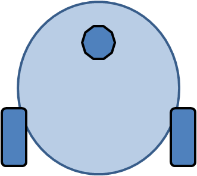↑

    
Forward

  

  

    
↓↓

    
Backward

  

  

    
↓↑

    
Left

  

  

    
↑↓

    
Right

  

---
title: Types of Motion (Contd..)
kicker: Basic Movements of Robot · Motions of Robot
---

  

    
↑

    
Soft-Right

  

  

    
↑

    
Soft-Left

  

  

    
↓

    
Backward Left

  

  

    
↓

    
Backward Right

  

---
title: Direction Control of DC Motor
kicker: Basic Movements of Robot · Motions of Robot
---

  <figure v-click>
    <figcaption>Anti-Clockwise Motion</figcaption>
    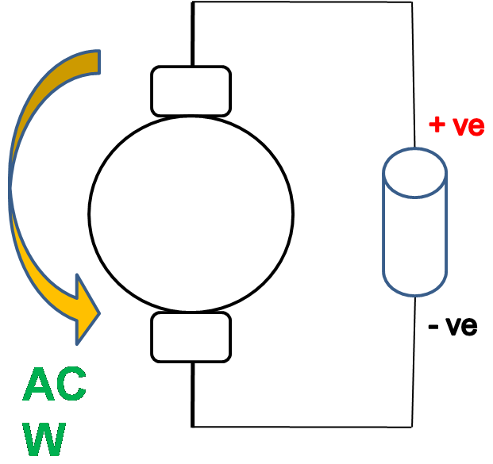
  </figure>
  <figure v-click>
    <figcaption>Clockwise Motion</figcaption>
    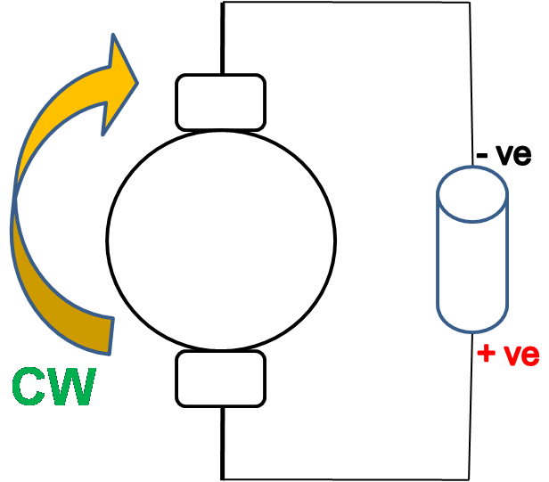
  </figure>

---
title: H-Bridge Motor Driver Circuit
kicker: Basic Movements of Robot · Motions of Robot
---

<v-clicks>

- An H-Bridge is used to control the direction of a DC motor.
- It consists of four switching elements (Q1–Q4).
- The motor is placed in the center of the bridge.
- Diodes protect the circuit from back EMF.

</v-clicks>

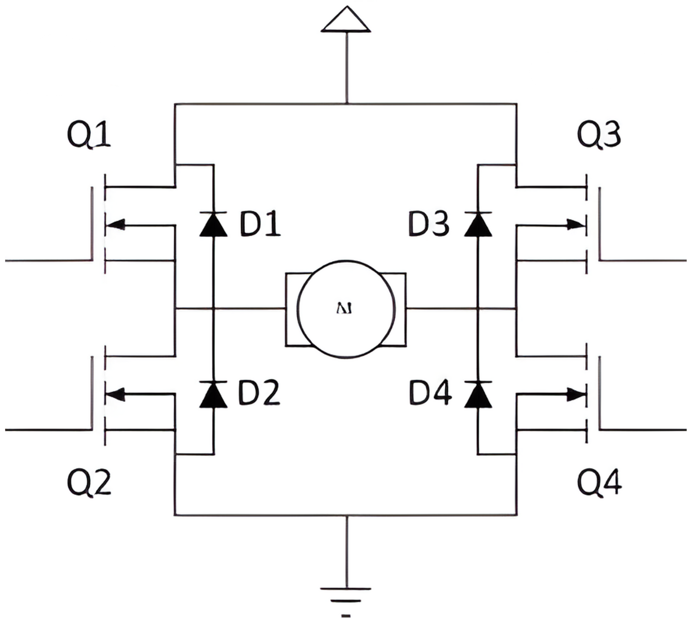

---
title: Current Flow in H-Bridge
kicker: Basic Movements of Robot · Motions of Robot
---

<v-clicks>

- When Q1 and Q4 turn ON, current flows in one direction.
- The motor rotates in the forward direction.
- When Q2 and Q3 turn ON, current direction reverses.
- Motor rotates in the opposite direction.

</v-clicks>

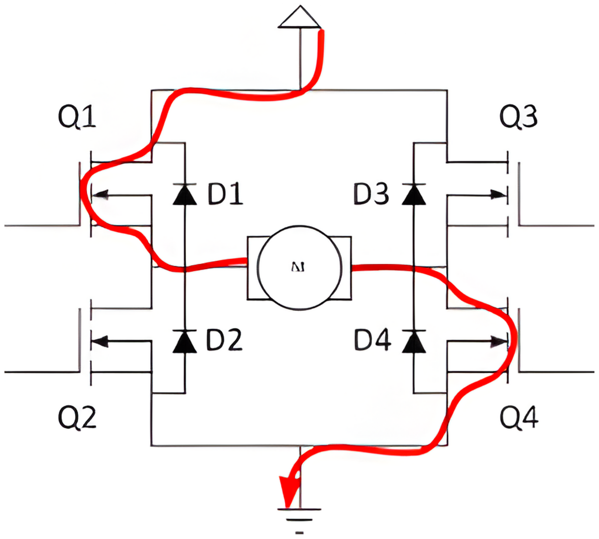

---
title: Need for TB6612FNG Motor Driver IC
kicker: Basic Movements of Robot · Understanding TB6612FNG IC
routeAlias: tb6612
class: centered gap-6
---

<v-clicks>

1. A microcontroller I/O pin can source only about 20 mA of current.
2. This limitation restricts it from driving high-power devices directly.
3. Motors require much higher current during operation.
4. Direct connection can result in unreliable behavior.
5. A dedicated interface is therefore needed between the controller and the motor.
6. TB6612FNG performs this role by handling the load safely.

</v-clicks>

---
title: TB6612FNG IC
kicker: Basic Movements of Robot · Understanding TB6612FNG IC
---

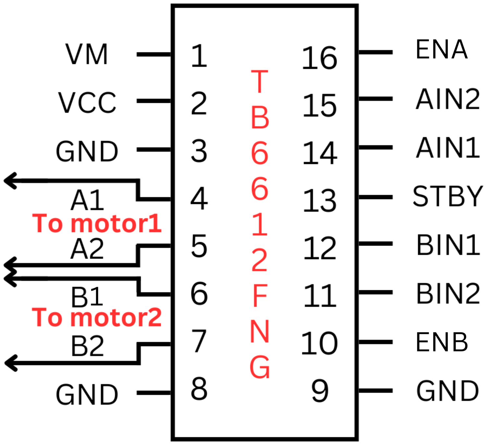

---
title: TB6612FNG IC
kicker: Basic Movements of Robot · Understanding TB6612FNG IC
class: centered
---

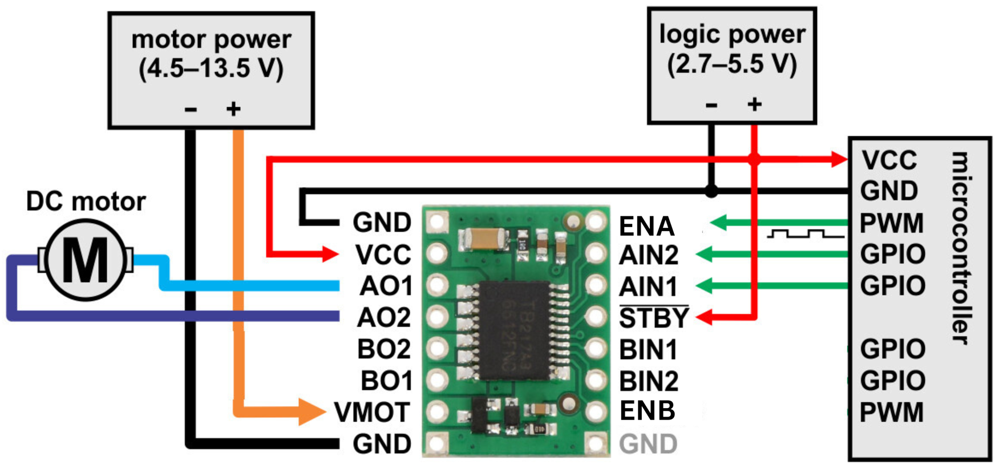

---
title: Motor Pin Connection
kicker: Motor Interfacing on Spark bot · Pin connections
routeAlias: pins
class: alpha-sub title-gap
---

<v-clicks depth="2">

1. Four Pins are used for Direction control
   1. AIN1 - Left Motor Control
   2. AIN2 - Left Motor Control
   3. BIN1 - Right Motor Control
   4. BIN2 - Right Motor Control
2. Two Pins are used for Enabling Motor Driver IC
   1. ENA - Left Channel Enable
   2. ENB - Right Channel Enable

</v-clicks>

---
title: Logic Table
kicker: Motor Interfacing on Spark bot · Logic Table
routeAlias: logic
---

<table class="logic">
  <thead>
    <tr><th rowspan="2">Direction</th><th>AIN1</th><th>AIN2</th><th>BIN1</th><th>BIN2</th></tr>
    <tr><th>LF</th><th>LB</th><th>RB</th><th>RF</th></tr>
  </thead>
  <tbody>
    <tr><td>Forward</td><td>1</td><td>0</td><td>0</td><td>1</td></tr>
    <tr><td>Backward</td><td>0</td><td>1</td><td>1</td><td>0</td></tr>
    <tr><td>Left</td><td>0</td><td>1</td><td>0</td><td>1</td></tr>
    <tr><td>Right</td><td>1</td><td>0</td><td>1</td><td>0</td></tr>
    <tr><td>Soft Left</td><td>0</td><td>0</td><td>0</td><td>1</td></tr>
    <tr><td>Soft Right</td><td>1</td><td>0</td><td>0</td><td>0</td></tr>
    <tr><td>Stop</td><td>0</td><td>0</td><td>0</td><td>0</td></tr>
  </tbody>
</table>

---
title: How the Motor Driver is Connected
kicker: Motor Interfacing on Spark Bot · Interfacing
routeAlias: motor-interface
class: enc-slide
---

  
<b>Master controller</b>Arduino Uno (ATmega328P)

  
Direction + speed signals<i>→</i>

  
<b>Motor driver</b>TB6612FNG (U11)

  
Motor power<i>→</i>

  
<b>DC motors</b>Right + Left wheel

<v-clicks at="4">

1. **Master controller:** decides the direction and speed of each motor and sends these signals directly to the motor driver.
2. **Motor driver:** takes these logic signals and switches the motor supply to the motors.
3. **DC motors:** one channel drives the right motor, the other drives the left motor.

</v-clicks>

---
title: What is an Encoder?
kicker: Wheel Encoders on Spark Bot · Encoder
routeAlias: encoder
class: enc-slide
---

<v-clicks>

- An encoder converts the rotation of a wheel into electrical pulses.
- A disc with alternating marks turns with the wheel; a sensor detects each mark.
- Counting pulses tells how far and how fast the wheel has turned.

</v-clicks>

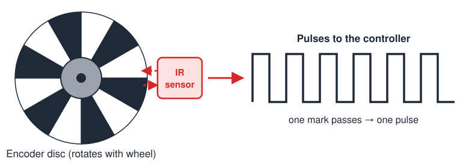

---
title: Working of a Reflective IR Encoder
kicker: Wheel Encoders on Spark Bot · Encoder
class: enc-slide
---

<v-clicks>

- The sensor has an IR LED and a photo-transistor side by side, facing the marks.
- White mark → IR light reflects back → photo-transistor turns **ON**.
- Black mark → IR light is absorbed → photo-transistor stays **OFF**.
- As the wheel turns, ON / OFF repeats → one pulse per mark.

</v-clicks>

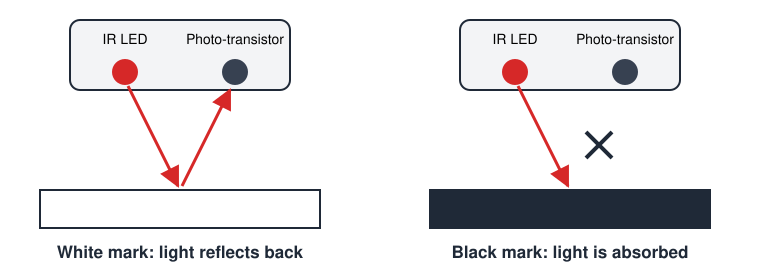

---
title: Encoders in Motion Control
kicker: Wheel Encoders on Spark Bot · Motion control
routeAlias: encoder-motion
class: title-gap roomy
---

<v-clicks>

- **Distance:** count pulses to move an exact distance
- **Speed:** pulses per second gives wheel speed
- **Straight line:** match left and right pulse counts
- **Accurate turns:** count pulses to turn by an angle
- **Stall check:** motor ON but no pulses → wheel is stuck

</v-clicks>

---
title: Encoder Circuit on Spark Bot
kicker: Wheel Encoders on Spark Bot · IR sensor + Schmitt trigger
routeAlias: encoder-circuit
layout: two-cols
class: cols-center enc-circuit
---

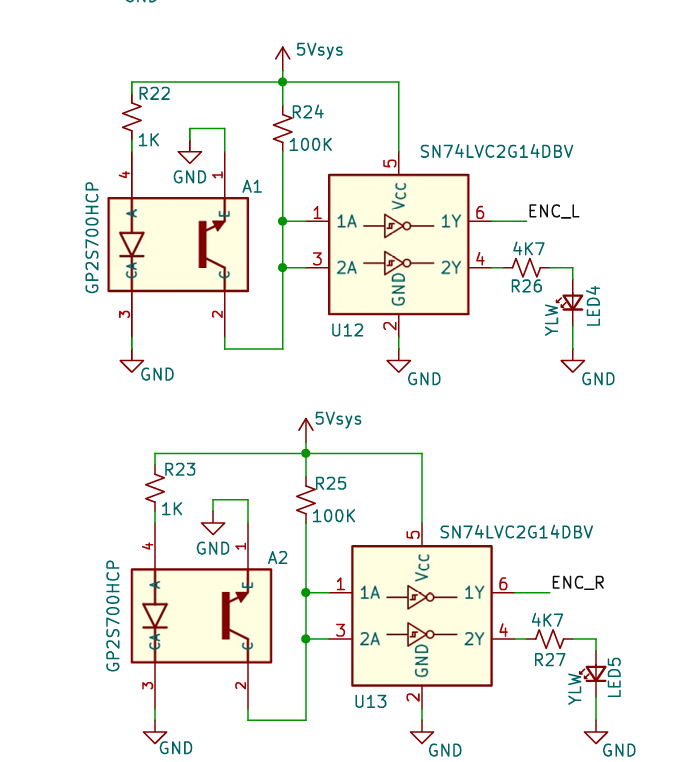

::right::

<v-clicks>

1. **GP2S700HCP** – reflective IR sensor (IR LED + photo-transistor)
2. **SN74LVC2G14** – dual Schmitt-trigger inverter cleans the signal
3. **ENC_L / ENC_R** – encoder output signal for each wheel

</v-clicks>

---
title: Why a Schmitt Trigger?
kicker: Wheel Encoders on Spark Bot · IR sensor + Schmitt trigger
class: enc-slide
---

<v-clicks>

- The photo-transistor output changes **slowly** and carries **noise**.
- A gate with **one threshold** flips many times near it → false extra counts.
- A **Schmitt trigger** has two thresholds: goes HIGH above **VT+**, LOW only below **VT−**.

</v-clicks>

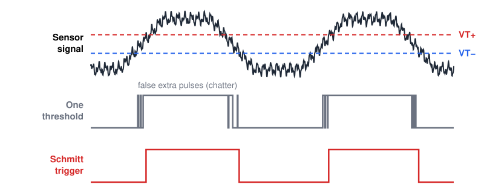

---
title: How the Encoder is Connected
kicker: Wheel Encoders on Spark Bot · Interfacing
routeAlias: encoder-interface
class: enc-slide
---

  
<b>Encoder</b>GP2S700HCP + SN74LVC2G14

  
ENCODER_DATA ENC_L / ENC_R<i>→</i>

  
<b>Slave controller</b>ATmega328P (U5)

  
I2C (SDA / SCL)<i>→</i>

  
<b>Master controller</b>Arduino Uno (ATmega328P)

<v-clicks at="4">

1. **Encoder:** turns each wheel mark into a clean pulse for the left and right wheel.
2. **Slave controller:** receives the pulses as interrupts and counts them.
3. **Master controller:** reads the counts from the slave over I2C and uses them for motion control.

</v-clicks>

---
layout: end
title: Thank You!
subtitle: e-Yantra Workshop Series · IIT Bombay
contact: "Post your queries on: support@e-yantra.org"
---
