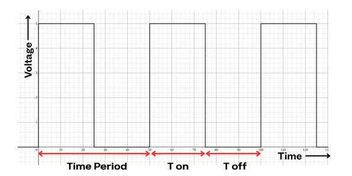
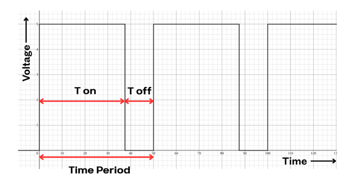
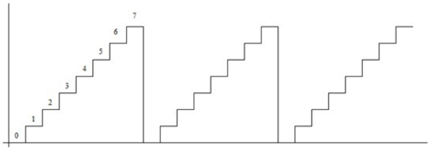
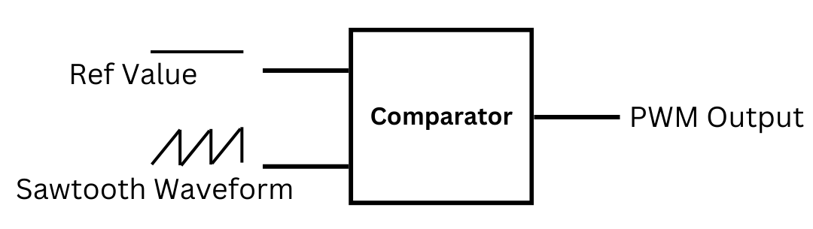
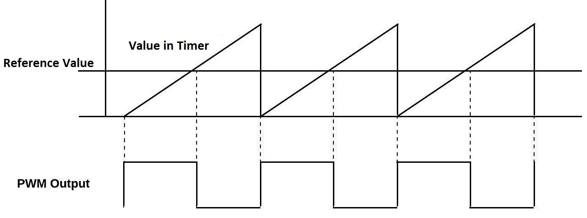
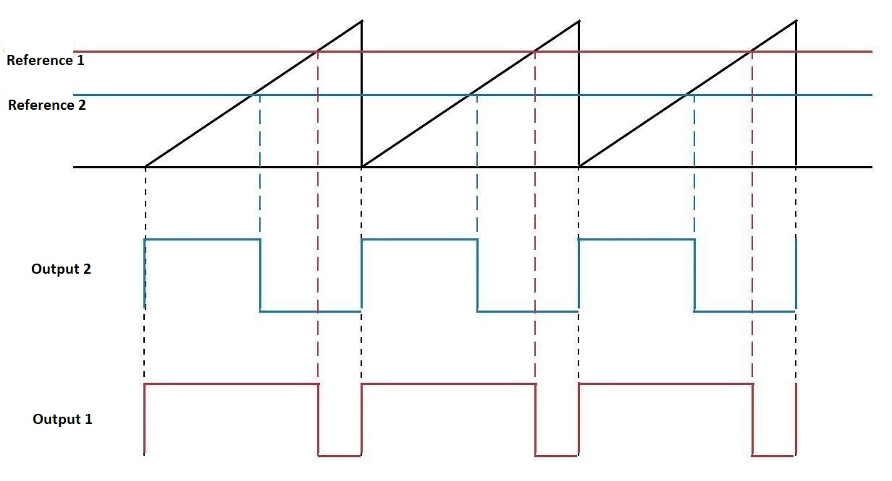
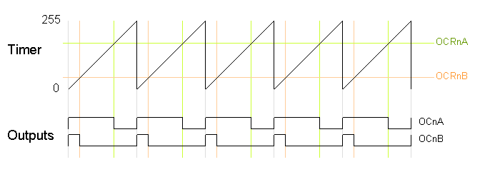
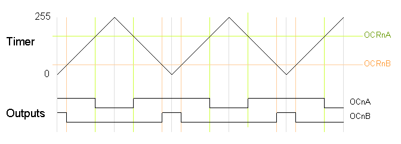
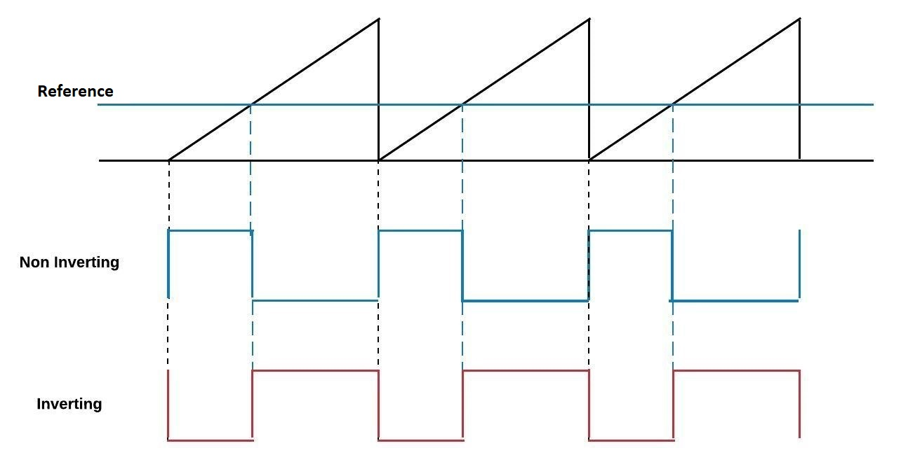

---
title: Agenda for Discussion
kicker: Outline
routeAlias: agenda
class: agenda-slide
---

  

    
1 · Introduction

    <Link to="need-pwm" class="agenda-item">
01

Need for PWM
</Link>
    <Link to="pwm" class="agenda-item">
02

Pulse Width Modulation
</Link>
    <Link to="duty" class="agenda-item">
03

Duty Cycle
</Link>
  

  

    
2 · PWM Generation in AVR

    <Link to="bitbang" class="agenda-item">
04

Bit-banging Pulse Width Modulation
</Link>
    <Link to="timers" class="agenda-item">
05

Timers in AVR
</Link>
    <Link to="counter" class="agenda-item">
06

Timer/Counter
</Link>
    <Link to="pwm-types" class="agenda-item">
07

Type of PWM
</Link>
    <Link to="pwm-freq" class="agenda-item">
08

PWM Frequency
</Link>
  

---
title: Why Do We Need PWM?
kicker: Introduction · Need for PWM
routeAlias: need-pwm
class: centered wide-gaps big-pts
---

<v-clicks>

1. To control power delivered to a device without wasting energy as heat
2. To allow microcontrollers to simulate analog output using digital pins
3. To efficiently vary speed, brightness, or position using digital signals

</v-clicks>

---
title: Pulse Width Modulation (PWM)
kicker: Introduction · Pulse Width Modulation
routeAlias: pwm
class: centered wide-gaps big-pts
---

<v-clicks>

1. Pulse Width Modulation (PWM) is a technique used to control analog output using digital signals
2. The output voltage or power is controlled by varying the duty cycle of a fixed-frequency digital signal
3. Applications include motor speed control, LED brightness control, and servo motor positioning

</v-clicks>

---
title: Duty Cycle
kicker: Introduction · Duty Cycle
routeAlias: duty
class: pwm-slide
---

<v-clicks>

1. The signal alternates between ON and OFF.
2. When ON the output is 5V; when OFF the output is 0V.

</v-clicks>

---
title: Duty Cycle (Contd.)
kicker: Introduction · Duty Cycle
class: centered mid-gaps
---

<v-clicks>

1. $T_{on}$ = Time the output remains HIGH.
2. $T_{off}$ = Time the output remains LOW.
3. Time Period $(T) = T_{on} + T_{off}$.
4. Duty Cycle $= \dfrac{T_{on} \times 100}{T_{on} + T_{off}}$.
5. Example: $T_{on} = T_{off} \Rightarrow$ Duty Cycle $= 50\%$.
6. <a class="pwm-link" href="https://www.desmos.com/calculator/oyp4umxwnd" target="_blank">Click to view interactive waveform (Desmos)</a>

</v-clicks>

---
title: Duty Cycle (Contd..)
kicker: Introduction · Duty Cycle
class: pwm-slide
---

<v-clicks>

1. Ton = Time the output remains high = 37.5
2. Toff = Time the output remains Low = 12.5
3. Duty Cycle = 75%

</v-clicks>

---
title: Bit-banging Pulse Width Modulation
kicker: PWM Generation in AVR · Bit-banging
routeAlias: bitbang
class: centered wide-gaps big-pts
---

<v-clicks>

1. PWM can be generated by repeatedly setting a pin HIGH and LOW using software instructions
2. The pulse width is controlled using delay functions to adjust ON and OFF time
3. This method causes execution delays and becomes unreliable as complexity increases.

</v-clicks>

---
title: Timers in AVR
kicker: PWM Generation in AVR · Timers in AVR
routeAlias: timers
class: centered mid-gaps
---

<v-clicks depth="2">

1. The ATmega328P microcontroller includes **three internal timers**
   - **Timer0 and Timer2 (8-bit)** each provides **2 PWM output channels**
   - **Timer1 (16-bit)** provides **2 high-resolution PWM outputs**
2. Total available PWM outputs: **6 channels**
3. Motor speed control typically requires **one PWM output per motor**

</v-clicks>

---
title: Timer / Counter
kicker: PWM Generation in AVR · Timer/Counter
routeAlias: counter
class: pwm-split
---

<v-clicks>

1. A Timer/Counter is a hardware register that increments automatically with each clock pulse
2. The counting range depends on the **bit-width (resolution)** of the counter
3. For example, a **3-bit counter** has $2^3 = 8$ possible states (0–7), as shown
4. In general, for an **n-bit counter**: 
Maximum count $= 2^n - 1$

</v-clicks>

---
title: PWM Generation in AVR
kicker: PWM Generation in AVR · Timer/Counter
class: pwm-slide
---

Pulse width waveform generated for motion control is:

---
title: PWM using Output Compare Registers
kicker: PWM Generation in AVR · Timer/Counter
class: centered mid-gaps
---

<v-clicks>

- Each timer module has **two Output Compare Registers**.
- These registers define the **pulse width** of PWM signals.
- When the timer value matches a compare register, the output state changes.
- Both outputs run at the **same frequency**.
- Each output can generate a **different duty cycle** based on its own compare value.

</v-clicks>

---
title: PWM signal for Left and Right motor
kicker: PWM Generation in AVR · Timer/Counter
class: pwm-slide
---

---
title: Fast PWM Mode
kicker: PWM Generation in AVR · Type of PWM
routeAlias: pwm-types
class: pwm-slide
---

<v-clicks>

- The timer continuously counts from **0 to 255**.
- The output turns **ON** when the timer resets to 0.
- The output turns **OFF** when the timer matches the Output Compare value.
- A **higher compare value** results in a **larger duty cycle**.

</v-clicks>

---
title: Phase Correct PWM Mode
kicker: PWM Generation in AVR · Type of PWM
class: pwm-slide pwm-tight
---

<v-clicks>

- The timer counts **up from 0 to 255** and then **back down to 0**.
- The output turns **OFF** when the timer matches the compare value on the way up.
- The output turns **ON** when the timer matches the compare value on the way down.
- This produces a **symmetrical waveform**.
- The output frequency is **approximately half** that of Fast PWM mode.

</v-clicks>

---
title: "Comparison: Fast PWM vs Phase Correct PWM"
kicker: PWM Generation in AVR · Type of PWM
class: pwm-cmp
---

<table class="pwm-table">
  <thead>
    <tr><th>Feature</th><th>Fast PWM</th><th>Phase Correct PWM</th></tr>
  </thead>
  <tbody>
    <tr v-click><td><b>Counting Pattern</b></td><td>Counts up only (0 to 255)</td><td>Counts up then down (0 to 255 to 0)</td></tr>
    <tr v-click><td><b>Frequency</b></td><td>Higher (∼2x)</td><td>Lower (∼0.5x)</td></tr>
    <tr v-click><td><b>Waveform</b></td><td>Asymmetric</td><td>Symmetric</td></tr>
    <tr v-click><td><b>Update Point</b></td><td>At TOP</td><td>At BOTTOM</td></tr>
    <tr v-click><td><b>Best For</b></td><td>Motor control, LED dimming</td><td>Audio signals, symmetric loads</td></tr>
    <tr v-click><td><b>Duty Cycle Resolution</b></td><td>Same (256 steps)</td><td>Same (256 steps)</td></tr>
  </tbody>
</table>

---
title: Different type of PWM Output
kicker: PWM Generation in AVR · Type of PWM
class: pwm-slide
---

---
title: PWM Output Modes
kicker: PWM Generation in AVR · Type of PWM
class: pwm-modes
---

<v-clicks depth="2">

- PWM output behavior depends on the **Compare Output Mode**.
- **Non-Inverting Mode:**
  - Output is set **HIGH** at the start of the cycle.
  - Output goes **LOW** when the timer matches the compare value.
  - Increasing compare value $\Rightarrow$ **higher duty cycle**.
- **Inverting Mode:**
  - Output is set **LOW** at the start of the cycle.
  - Output goes **HIGH** when the timer matches the compare value.
  - Increasing compare value $\Rightarrow$ **lower duty cycle**.

</v-clicks>

---
title: PWM Frequency
kicker: PWM Generation in AVR · PWM Frequency
routeAlias: pwm-freq
class: pwm-freq
---

<table class="pwm-table freq">
  <thead>
    <tr><th>Prescaler (N)</th><th>Fast PWM (Hz)</th><th>Phase Correct PWM (Hz)</th></tr>
  </thead>
  <tbody>
    <tr><td>1</td><td>62,500</td><td>31,372</td></tr>
    <tr><td>8</td><td>7,812</td><td>3,921</td></tr>
    <tr><td>64</td><td>976</td><td>490</td></tr>
    <tr><td>256</td><td>244</td><td>122</td></tr>
    <tr><td>1024</td><td>61</td><td>30</td></tr>
  </tbody>
</table>

**Fast PWM Frequency:**

$$f_{PWM} = \frac{f_{clock}}{N \times (1 + TOP)}$$

**Phase Correct PWM Frequency:**

$$f_{PWM} = \frac{f_{clock}}{2 \times N \times TOP}$$

**Where:**

- $f_{clock} = 16$ MHz
- $N$ = Prescaler value
- $TOP = 255$ (for 8-bit timer)

---
title: Arduino API for PWM
kicker: PWM Generation in AVR · PWM Frequency
class: pwm-api
---

analogWrite(Pin, DutyCycle)

Pin: Pin is one of the PWM pins (3, 5, 6, 9, 10, or 11).

<b class="red">Important:</b> Not all digital pins support PWM.

DutyCycle: Duty Cycle is a value from 0 to 255.

**Note: Default Settings**

1. Pin 3, 11 (Timer 2) Pin 9, 10 (Timer 1): ∼ freq 490 Hz (Phase-Correct PWM)
2. Pin 5, 6 (Timer 0): ∼ freq 980Hz (Fast PWM)

---
layout: end
title: Thank You!
subtitle: e-Yantra Workshop Series · IIT Bombay
contact: "Post your queries on: support@e-yantra.org"
---
