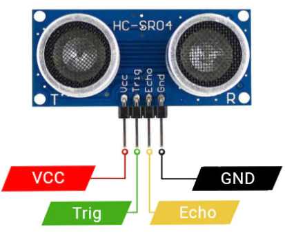
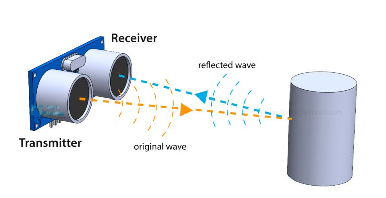
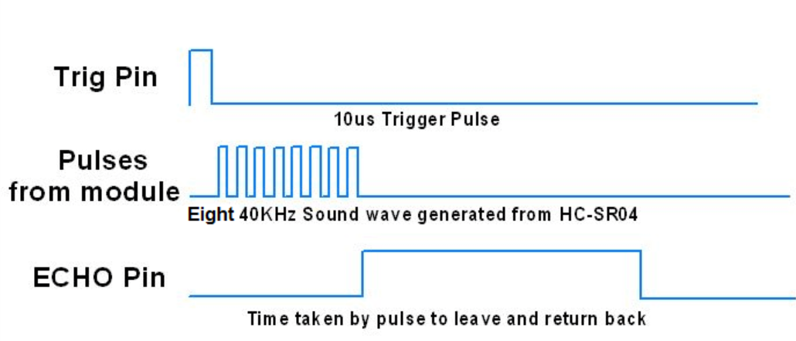

---
title: Agenda for Discussion
kicker: Outline
routeAlias: agenda
class: agenda-slide
---

  
1 · Ultrasonic Sensor

  <Link to="what" class="agenda-item">
01

What is Ultrasonic Sensor?
</Link>
  <Link to="features" class="agenda-item">
02

HC-SR04 Features
</Link>
  <Link to="pins" class="agenda-item">
03

Pin Description
</Link>
  <Link to="working" class="agenda-item">
04

Working Principle
</Link>
  <Link to="distance" class="agenda-item">
05

Distance Calculation
</Link>

---
title: What is an Ultrasonic Sensor?
kicker: Ultrasonic Sensor · What is Ultrasonic Sensor?
routeAlias: what
class: centered wide-gaps big-pts
---

<v-clicks>

- Ultrasonic sensor is a non-contact distance measurement sensor.
- Works on ultrasonic wave reflection principle.
- Uses high-frequency 40 kHz sound pulses.
- Provides accurate short-range distance sensing.

</v-clicks>

---
title: HC-SR04 Features
kicker: Ultrasonic Sensor · HC-SR04 Features
routeAlias: features
class: centered us-gaps big-pts
---

<v-clicks>

- Operating Voltage: 5V DC.
- Operating Current: 15 mA.
- Frequency: 40 kHz ultrasonic sound.
- Range: 2 cm to 400 cm (approx. 4 m).
- Accuracy: around 3 mm.

</v-clicks>

---
title: HC-SR04 Pin Connections
kicker: Ultrasonic Sensor · HC-SR04 Features
class: us-fig-slide
---

---
title: HC-SR04 Pin Description
kicker: Ultrasonic Sensor · Pin Description
routeAlias: pins
class: centered wide-gaps big-pts
---

<v-clicks>

- VCC — Power input (5V).
- TRIG — Input pin to start measurement.
- ECHO — Output pulse proportional to distance.
- GND — Ground connection.

</v-clicks>

---
title: How does the Ultrasonic Sensor Work?
kicker: Ultrasonic Sensor · Working Principle
routeAlias: working
class: centered wide-gaps big-pts
---

<v-clicks>

- Microcontroller sends a $\geq 10\mu s$ trigger pulse.
- Sensor emits 8 pulses at 40 kHz.
- Sound waves travel and hit an obstacle.
- Echo pin stays HIGH for the duration of return time.

</v-clicks>

---
title: How is Distance Calculated?
kicker: Ultrasonic Sensor · Distance Calculation
routeAlias: distance
class: centered wide-gaps big-pts
---

<v-clicks>

- Measurement is based on time-of-flight of sound.
- Speed of sound $\approx$ 0.0343 cm/$\mu$s.
- Formula: Distance = (Time $\times$ Speed of sound) / 2.
- Division by 2 because sound travels to object and back.

</v-clicks>

---
title: Distance Measurement
kicker: Ultrasonic Sensor · Distance Calculation
class: us-fig-slide
---

Distance = (Time $\times$ Speed of sound) / 2.

---
title: HC-SR04 Working
kicker: Ultrasonic Sensor · Distance Calculation
class: us-fig-slide
---

---
layout: end
title: Thank You!
subtitle: e-Yantra Workshop Series · IIT Bombay
contact: "Post your queries on: support@e-yantra.org"
---
