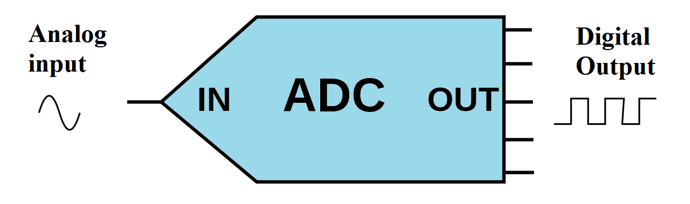
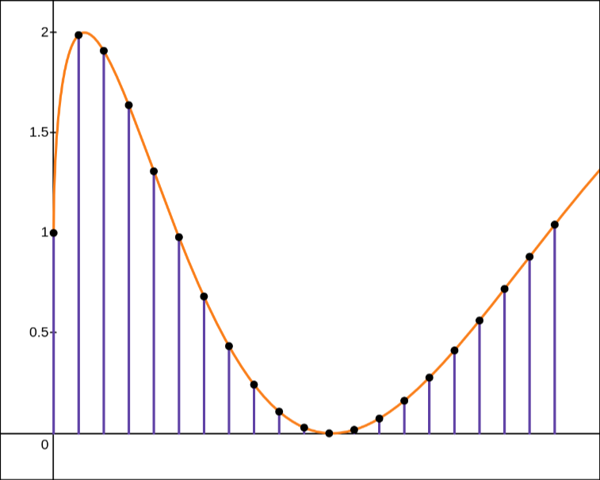
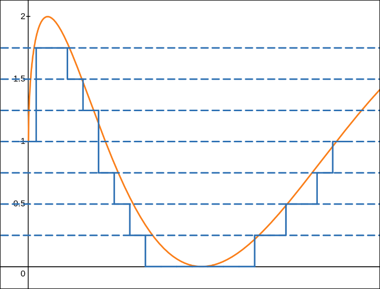
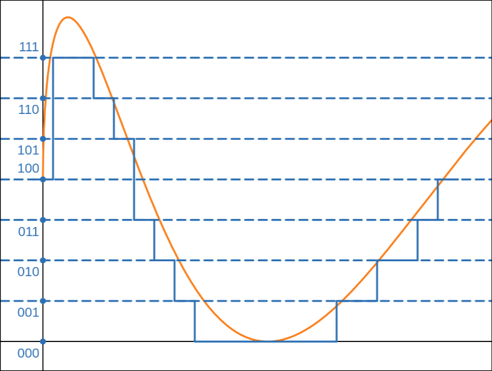
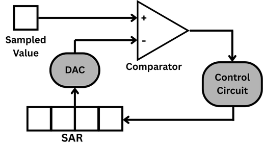
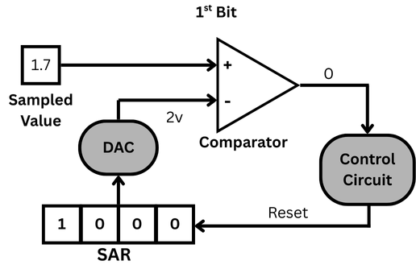
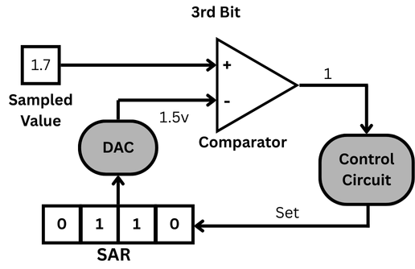
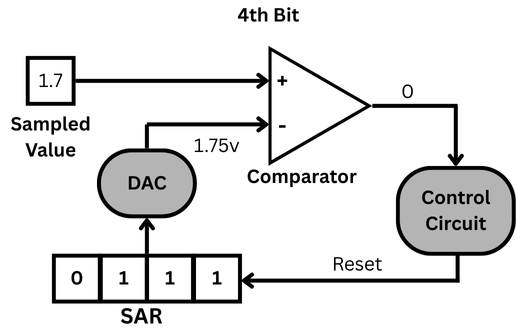
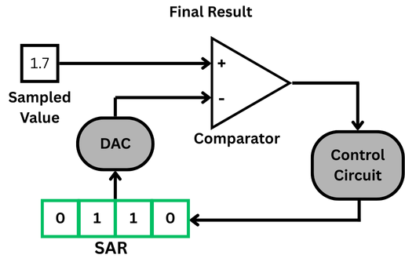
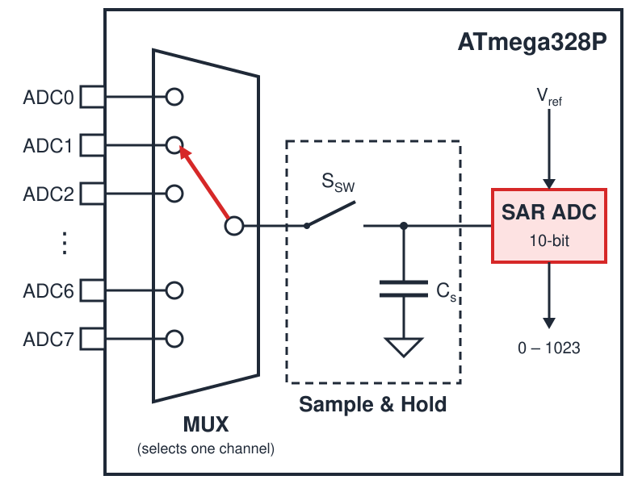

---
title: Agenda for Discussion
kicker: Outline
routeAlias: agenda
class: agenda-slide
---

  

    
1 · Analog to Digital Conversion

    <Link to="what" class="agenda-item">
01

What is an ADC
</Link>
    <Link to="need" class="agenda-item">
02

Need for ADC
</Link>
    <Link to="sampling" class="agenda-item">
03

Sampling
</Link>
    <Link to="quantization" class="agenda-item">
04

Quantization
</Link>
    <Link to="encoding" class="agenda-item">
05

Encoding
</Link>
    <Link to="sar" class="agenda-item">
06

SAR ADC
</Link>
    <Link to="atmega-adc" class="agenda-item">
07

ADC of ATmega328p
</Link>
  

  

    
2 · ADC on Spark Bot

    <Link to="spark-adc" class="agenda-item">
08

Sensor connection
</Link>
    <Link to="internal-adc" class="agenda-item">
09

Internal ADC
</Link>
  

---
title: What is an ADC
kicker: Analog to Digital Conversion · What is an ADC
routeAlias: what
class: adc-what
---

<v-clicks>

- Converts a signal from analog (continuous) to digital (discrete) form
- It involves three steps:

</v-clicks>

<ol v-click="2" class="adc-steps">
  <li>Sampling</li>
  <li>Quantization</li>
  <li>Encoding</li>
</ol>

---
title: Why Do We Need an ADC?
kicker: Analog to Digital Conversion · Need for ADC
routeAlias: need
class: adc-need
---

<ul>
  <li v-click="1"><b>Do real-world signals come in digital form?</b>
most physical signals are analog.
</li>
  <li v-click="3"><b>Can a microcontroller understand analog signals directly?</b>
it only understands digital values.
</li>
  <li v-click="5"><b>Where can we commonly use ADC?</b>
IR sensors, temperature sensors, battery monitors, white line sensors, etc.
</li>
  <li v-click="7"><b>Simulation Link</b>
<a class="pwm-link" href="https://www.desmos.com/calculator/aaqabmckaz" target="_blank">https://www.desmos.com/calculator/aaqabmckaz</a>
</li>
</ul>

---
title: Sampling
kicker: Analog to Digital Conversion · Sampling
routeAlias: sampling
class: adc-split adc-sampling
---

<v-clicks>

- Samples are discrete numbers which represent the amplitude of an input signal taken at different points in time.
- why sampling?
- Sampling holds the changing analog signal steady to ensure accurate conversion.
- Minimum Sampling rate should be twice that of the frequency of the input signal

</v-clicks>

---
title: Quantization
kicker: Analog to Digital Conversion · Quantization
routeAlias: quantization
class: adc-split
---

<v-clicks>

- Continuous analog values must be represented using limited discrete output levels defined by ADC resolution.
- The analog value is rounded to the nearest available level, producing a discrete digital output depending on the resolution of the ADC.

</v-clicks>

---
title: Encoding
kicker: Analog to Digital Conversion · Encoding
routeAlias: encoding
class: adc-fig
---

<v-clicks>

- Encodes quantized signal into sequence of binary bits

</v-clicks>

---
title: Successive Approximation Register (SAR ADC)
kicker: Analog to Digital Conversion · SAR ADC
routeAlias: sar
class: centered wide-gaps big-pts
---

<v-clicks>

- **Step-by-Step Conversion**
- A SAR ADC is a type of Analog-to-Digital Converter that converts an analog voltage into a digital number by **guessing the answer step-by-step**, from the most significant bit **(MSB)** to the least significant bit **(LSB)**.

</v-clicks>

---
title: Successive Approximation Register (Example)
kicker: Analog to Digital Conversion · SAR ADC
class: adc-fig
---

Q: What is the 4-bit SAR ADC digital output for a 1.7 V sampled input using a 0-4 V input range?

  
  
  
  
  
  

---
title: ADC of ATmega328p
kicker: Analog to Digital Conversion · ADC of ATmega328p
routeAlias: atmega-adc
class: centered adc-list big-pts
---

<v-clicks>

- 10-bit Resolution
- Minimum voltage change $(V_{ref}/2^n)$
- 65 to 260 $\mu$s Conversion Time
- 6 Multiplexed Single Ended Input Channels 
- 0 - VCC ADC Input Voltage Range
- SAR type ADC
- ADC pins are available on PortC

</v-clicks>

---
title: How the Analog Sensors are Connected
kicker: ADC on Spark Bot · Interfacing
routeAlias: spark-adc
class: enc-slide
---

  
<b>Analog sensors</b>White line sensors (×5) + Battery voltage

  
Analog voltage<i>→</i>

  
<b>Slave controller</b>ATmega328P (U5) internal 10-bit ADC

  
I2C (SDA / SCL)<i>→</i>

  
<b>Master controller</b>Arduino Uno (ATmega328P)

<v-clicks at="4">

1. **No external ADC:** Spark Bot does not use a separate ADC IC.
2. **Slave controller:** converts the sensor voltages with its own internal ADC.
3. **Master controller:** reads the converted values from the slave over I2C.

</v-clicks>

---
title: Internal architecture of ADC in ATmega328P
kicker: ADC on Spark Bot · Internal ADC
routeAlias: internal-adc
class: adc-arch centered
---

<v-clicks>

1. **ADC0 – ADC7:** analog input pins.
2. **MUX:** selects one channel at a time.
3. **Sample:** switch closes, Cs charges to the input.
4. **Hold:** switch opens, Cs holds the voltage.
5. **SAR ADC:** converts it to a 10-bit value.

</v-clicks>

---
title: Calculation of Analog Value to Digital Value
kicker: ADC on Spark Bot · Internal ADC
class: adc-calc
---

**Generic formula for ADC mapping**

$$\text{Digital value} = \frac{V_{in} \times \text{ADC resolution}}{V_{ref}}$$

**ADC resolution** $= 2^{\,\text{bits}}$

<table class="pwm-table res-table">
  <thead><tr><th>ADC</th><th>2bits</th><th>Digital range</th></tr></thead>
  <tbody>
    <tr><td>8-bit</td><td>28 = 256</td><td>0 – 255</td></tr>
    <tr class="hl"><td>10-bit</td><td>210 = 1024</td><td>0 – 1023</td></tr>
    <tr><td>12-bit</td><td>212 = 4096</td><td>0 – 4095</td></tr>
  </tbody>
</table>

**Example:** 10-bit ADC, $V_{ref} = 5$ V

$$\frac{\textcolor{#2563eb}{1\,\text{V}} \times 1024}{5\,\text{V}} \approx \textcolor{#16a34a}{\mathbf{204}}$$

$$\frac{\textcolor{#2563eb}{2.5\,\text{V}} \times 1024}{5\,\text{V}} = \textcolor{#16a34a}{\mathbf{512}}$$

$$\frac{\textcolor{#2563eb}{3.3\,\text{V}} \times 1024}{5\,\text{V}} \approx \textcolor{#16a34a}{\mathbf{675}}$$

$$\frac{\textcolor{#2563eb}{4\,\text{V}} \times 1024}{5\,\text{V}} \approx \textcolor{#16a34a}{\mathbf{819}}$$

---
layout: end
title: Thank You!
subtitle: e-Yantra Workshop Series · IIT Bombay
contact: "Post your queries on: support@e-yantra.org"
---
