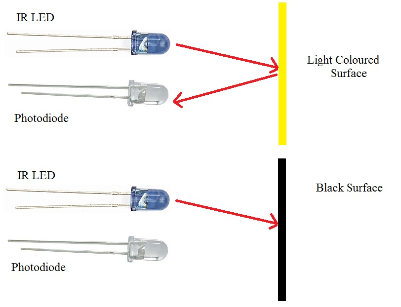
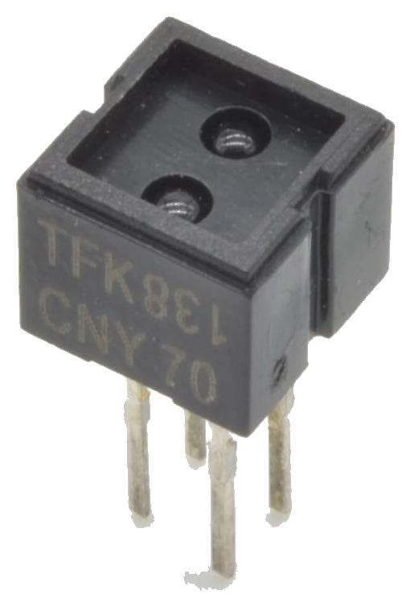
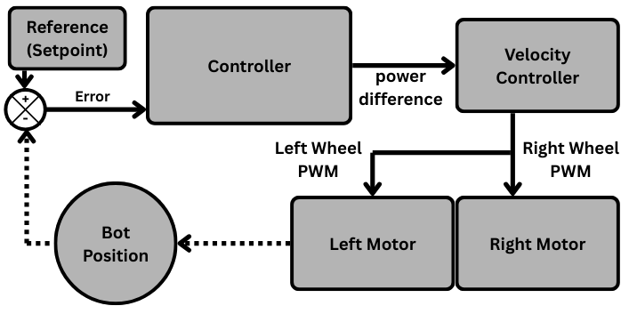
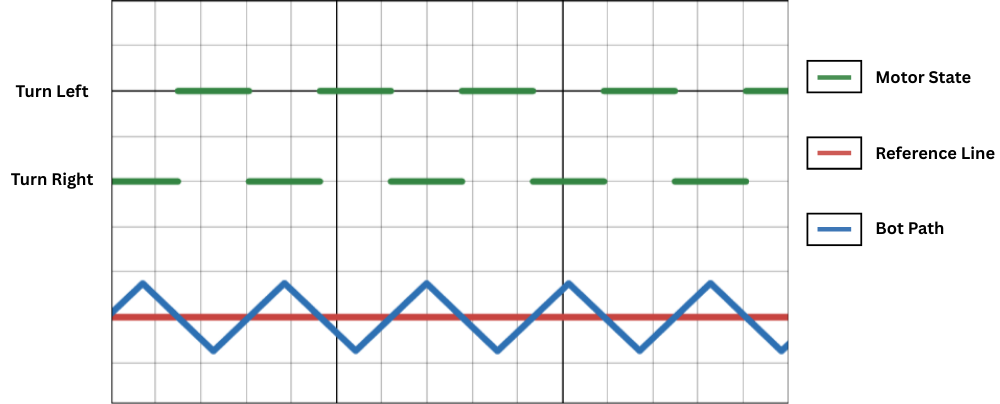
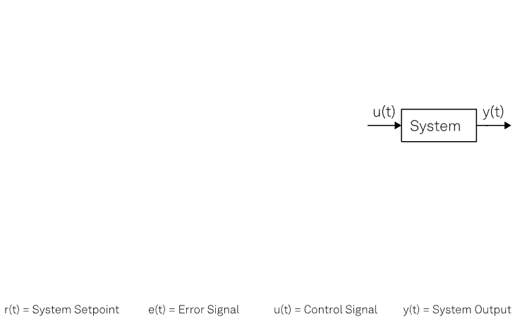
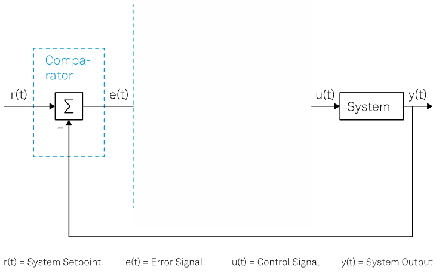
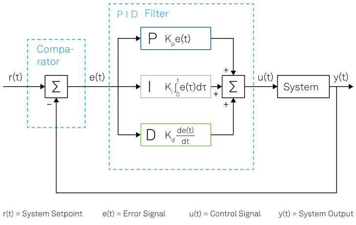

---
title: Agenda for Discussion
kicker: Outline
routeAlias: agenda
class: agenda-slide
---

  

    <Link to="wlf" class="agenda-item">
01

WLF sensor
</Link>
    <Link to="controller" class="agenda-item">
02

What is a Controller?
</Link>
    <Link to="bangbang" class="agenda-item">
03

Bang-Bang Controller
</Link>
    <Link to="calibration" class="agenda-item">
05

Calibration
</Link>
  

  

    
04 · PID Controller

    <Link to="error" class="agenda-item">
4.1

Error Calculation
</Link>
    <Link to="weighted" class="agenda-item">
4.2

Weighted Average
</Link>
    <Link to="p" class="agenda-item">
4.3

P Controller
</Link>
    <Link to="pd" class="agenda-item">
4.4

PD Controller
</Link>
    <Link to="pid" class="agenda-item">
4.5

PID Controller
</Link>
    <Link to="velocity" class="agenda-item">
4.6

Velocity Control
</Link>
  

---
title: Line Tracker Sensor
kicker: WLF sensor
routeAlias: wlf
class: lf-split
---

<v-clicks>

- Five line sensor - five analog outputs
- Higher infrared reflectance (in white) – larger output value
- Lower infrared reflectance (in black) – smaller output value

</v-clicks>

---
title: WLF Sensor
kicker: WLF sensor
class: lf-wlf centered
---

<v-clicks>

- CNY70 infrared reflective sensor (IR LED + photo-transistor)
- Operating voltage: 5V
- Induction distance: 0mm – 5mm
- 5 channel
- Connection - slave controller ADC channels

</v-clicks>

---
title: What is a Controller?
kicker: What is a Controller?
routeAlias: controller
class: centered wide-gaps big-pts
---

<v-clicks>

- A controller is the decision maker that constantly adjusts a system’s input based on the difference between desired and actual output.
- We will be using controller to read the position of the bot on the line and keep correcting it as it moves.
- Types of controllers: Bang-Bang Controller, PID Controller, Fuzzy Logic Controller, etc.

</v-clicks>

---
title: Using a controller
kicker: What is a Controller?
class: lf-fig
---

<v-clicks>

- **Setpoint**: Desired position of the robot on the line.
- **Power Difference**: speed difference for differential stearing.

</v-clicks>

---
title: Bang Bang Controller
kicker: Bang-Bang Controller
routeAlias: bangbang
class: lf-bang
---

<v-clicks>

- Five line sensor - five analog outputs
- 5 sensors data in range 0 to 1023 (Approx. 1000)
- Threshold the value to get binary result \[0 if less then 250 else 1\]
- Total $2^5$ cases

</v-clicks>

  
0

1

0

0

0

<v-clicks at="5">

- Some cases can be ignored *(e.g., line on both extremes, not in middle)*
- If sensors detect line on left, turn left; else if on right, turn right.
- Multiple turn intensity levels based on sensor patterns (e.g., slight right, hard right).

</v-clicks>

---
title: Error calculation
kicker: PID Controller · Error Calculation
routeAlias: error
class: lf-fig
---

What was the problem in previous method?

<v-clicks>

- Can we update the turning sensitivity according to the error?
- for that we need to calculate how much error is there from the center of the line

</v-clicks>

---
title: Weighted Average
kicker: PID Controller · Weighted Average
routeAlias: weighted
class: lf-wavg
---

<v-clicks>

- 5 sensors data in range 0 to 1023 (Approx. 1000)
- Five detectors weight - \[0, 1000, 2000, 3000, 4000\]
- Weighted Average =

</v-clicks>

$$\frac{0 \times \text{value}_0 + 1000 \times \text{value}_1 + 2000 \times \text{value}_2 + 3000 \times \text{value}_3 + 4000 \times \text{value}_4}{\text{value}_0 + \text{value}_1 + \text{value}_2 + \text{value}_3 + \text{value}_4}$$

<v-clicks at="4">

- Cases:

</v-clicks>

<ol class="wavg-cases">
  <li v-click="5">0 – line is on the leftmost side</li>
  <li v-click="6">2000 – line is in the middle</li>
  <li v-click="7">4000 – line is on the rightmost side</li>
</ol>

<v-clicks at="8">

- simulation link: <a class="pwm-link" href="https://www.desmos.com/calculator/bhqnvzf0qs" target="_blank">https://www.desmos.com/calculator/bhqnvzf0qs</a>

</v-clicks>

---
title: Weighted Average Example
kicker: PID Controller · Weighted Average
class: lf-example
---

  
Sensor Readings

  

S1

S2

S3

S4

S5

  

100

700

100

50

50

  
Weights

  

0

1000

2000

3000

4000

  

0

700000

200000

150000

200000

**Weighted Average:** $\dfrac{1{,}700{,}000}{1000} = \boxed{1700}$

---
title: Flow for PID Controller
kicker: PID Controller · P Controller
class: lf-fig
---

  
  
  

---
title: Proportional Controller
kicker: PID Controller · P Controller
routeAlias: p
class: lf-p
---

<v-clicks>

- Setpoint is 2000
- error = weighted average − 2000
- Cases:

</v-clicks>

<ol class="p-cases">
  <li v-click="4">0 – Perfectly on line or no line</li>
  <li v-click="5">positive – line is on the right side</li>
  <li v-click="6">negative – line is on the left side</li>
</ol>

<v-clicks at="7">

- P_correction = error ∗ constant
- This constant is called as kp.
- simulation(luis Llamas): <a class="pwm-link" href="https://www.luisllamas.es/en/pid-controller-simulator/" target="_blank">https://www.luisllamas.es/en/pid-controller-simulator/</a>

</v-clicks>

---
title: Proportional+Derivative controller
kicker: PID Controller · PD Controller
routeAlias: pd
class: centered lf-list
---

<v-clicks>

- Problem with P controller: **overshooting**
- Derivative term predicts the future error based on its **current rate of change**
- Derivative = (error − previous_error)
- The more the rate of change, the more correction it does.
- PD_correction = P_correction + (derivative ∗ constant)
- This constant is called as kd.

</v-clicks>

---
title: PID Controller
kicker: PID Controller · PID Controller
routeAlias: pid
class: centered lf-list7
---

<v-clicks>

- Problem with PD controller: **steady state error**
- Integral term eliminates steady state error by considering the **cumulative sum of past errors**
- integral = (integral + error)
- The more the cumulative error, the more correction is needed
- PID_correction = PD_correction + (integral ∗ constant)
- This constant is called as ki.
- Power_Difference = P∗kp + D∗kd + I∗ki

</v-clicks>

---
title: Velocity Control
kicker: PID Controller · Velocity Control
routeAlias: velocity
class: lf-vel
---

Maximum - maximum velocity with which robot should travel

**Power Difference is positive:**

$v_l > v_r$ 
$v_l = \text{maximum}$ 
$v_r = \text{maximum} - \text{Power\_Difference}$

**Power Difference is negative:**

$v_l < v_r$ 
$v_l = \text{maximum} + \text{Power\_Difference}$ 
$v_r = \text{maximum}$

**Corner cases:** 
Power_Difference < (-maximum) then v_l = 0 and v_r = maximum 
Power_Difference > maximum then v_l = maximum and v_r = 0

---
title: Calibration
kicker: Calibration
routeAlias: calibration
class: lf-cal
---

<v-clicks depth="2">

1. Different sensors – different results – same color and distance
2. Environmental Factors – Lighting Conditions – different results
3. We may get:
   1. Actual Min – higher than 0
   2. Actual Max – lower than 1023
4. Normalization process – linear transformation from \[Min, Max\] to the range of \[0, 1000\]
5. Calibrated value = (Value - Min) * 1000 / (Max - Min)
6. For Line switching: Calibrated value = 1000 - Calibrated value

</v-clicks>

---
layout: end
title: Thank You!
subtitle: e-Yantra Workshop Series · IIT Bombay
contact: "Post your queries on: support@e-yantra.org"
---
